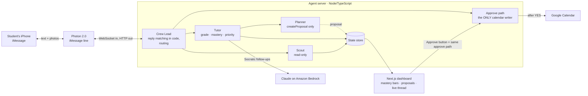

# Syllabus Crew

**A personal agent for students that lives in iMessage.** It knows what's on your exam, texts you quiz questions on what you're weak at, and proposes changes to your week. It asks before it acts.

> Study apps wait for you to open them. Syllabus Crew texts you.

Built at HackPrinceton Fall 2026. Your quiz answers rewrite your calendar, and nobody opens an app.

## The loop

1. **Scout** finds new material (e.g. "Prof. Lee posted Week 6 slides").
2. The **Tutor** texts a quiz question (`A) … B) … C) …`) on the topic that matters most: grade weight × weakness × how soon the exam is.
3. The student replies. The answer is **graded in code**, mastery updates in code, and a wrong answer gets a **Socratic follow-up**, not the answer.
4. The **Planner** texts a proposal: "Exam 2 is 25% and chapter 5 is your weak spot. Want me to add 30 minutes of review on Tuesday? Reply YES or NO."
5. The student replies **YES**, and the event appears in **Google Calendar**.

## Architecture



**Principle: use code for math, use the LLM for language.**

| In code (deterministic, tested) | LLM (Claude on Bedrock) |
|---|---|
| Grading A/B/C, mastery updates, priority score | Socratic follow-up questions |
| Matching YES/NO and A/B/C replies to the pending item | Free-text small talk |
| Quiet hours (11pm–8am), 3-per-day caps | (Planned) syllabus → JSON, quiz writing |
| **The approval gate:** the Planner has no calendar tool; only the approve path can write | |
| Slot picking, "in N days" counting | |

Hard rules are enforced in code, not prompts. A test fails if any file other than `approve.ts` can write to a calendar. The agent never texts anyone who hasn't texted the line first (Photon's inbound-first rule), and a slow or broken model can never leak an answer or stall the thread (every LLM output has a timeout, a fallback, and an acceptance check).

## What's real and what's staged

Real: iMessage via Photon, the router, grading/mastery/priority, Socratic follow-ups (Bedrock), proposals, the approve path writing to a real Google Calendar, the dashboard, quiet hours and caps, idempotent calendar writes.

Staged for the demo (so the loop never depends on live parsing): the syllabus photo's parse is a stored result, "Scout finds the slides" reads a pre-loaded inbox, and the quiz questions are hand-written seed data.

Real, but not part of the staged stage demo: **upload a real syllabus** (PDF or page images) at `/upload?key=<PRESENTER_KEY>`. Claude reads it, code validates it and does the math (weights, week-to-date, crunch weeks), the agent texts what it found and asks about anything missing, one question at a time, and understands date and percent answers in code.

For a real syllabus the Tutor writes its own questions on the readings that feed your next assignments. The model writes only the words; code validates the format, shuffles the A/B/C order and grades the answers, and a second independent model call must pick the same answer or the question is thrown away. Questions come from the model's knowledge of standard works, not the text itself, so a syllabus whose readings are obscure gets weaker questions.

**The agent texts you first, inside the conversation you started.** A scheduler runs every minute with hard rules enforced in code: a morning quiz once a day, nudges scaled to grade weight, how weak you are on a topic and how soon it's due (a 30% paper a week out, a 2% quiz only the night before), a short round offer you answer YES or NO to, "remind me Sunday to start the essay" reminders that are always delivered, and "pause" / "stop nudging me" / "resume". It never texts between 11pm and 8am, sends at most 3 a day, never interrupts a conversation or an open question, and backs off after two unanswered nudges. The decision logic is deterministic code; wording is templated. Set `SCHEDULER=on` to let it text for real (default `dry` only logs what it would send).

Not built yet: syllabus photos texted over iMessage being read for real (the first photo on Day 1 still loads the stored parse), questions grounded in your own slides or readings, calendar-feed (iCal) Scout, the Nudger, the morning scheduler. See `PLAN.md`.

## Run it

Requirements: Node 22+ (tested on 24), an iMessage-capable iPhone.

```bash
npm install
# create .env with the variables in the table below
npm test -w @syllabus-crew/core -w @syllabus-crew/agent   # 45 tests, no network
npm run demo:loop -w @syllabus-crew/agent                 # the whole loop on fakes, printed as a chat

npm run start -w @syllabus-crew/agent   # the real agent (Photon + Bedrock + Google Calendar)
npm run dev   -w @syllabus-crew/web     # dashboard at http://localhost:3000
```

Open `/join` on the dashboard for a QR code that opens Messages with the first text pre-filled. Presenter controls live at `/demo?key=<PRESENTER_KEY>` (a separate secret from the agent's `DEMO_ADMIN_TOKEN`). Both servers listen on this machine only.

### Setup

| What | Where |
|---|---|
| **Photon 2.0 beta** project + a shared iMessage line, with the user's number assigned | photon.codes/beta. `PHOTON_PROJECT_ID`, `PHOTON_API_KEY`, `PHOTON_IMESSAGE_LINE` |
| **AWS Bedrock**, Claude Haiku 4.5 (default) and Sonnet 4.6 enabled in `us-east-1` | `AWS_REGION`, `AWS_ACCESS_KEY_ID`, `AWS_SECRET_ACCESS_KEY`, `BEDROCK_MODEL_DEFAULT=us.anthropic.claude-haiku-4-5-20251001-v1:0`, `BEDROCK_MODEL_STRONG=us.anthropic.claude-sonnet-4-6` |
| **Google Calendar**: OAuth client (Testing mode), `calendar.events` scope only | `GOOGLE_CLIENT_ID`, `GOOGLE_CLIENT_SECRET`, `GOOGLE_REDIRECT_URI=http://localhost:8787/auth/google/callback`. Connect once at `/auth/google?token=<DEMO_ADMIN_TOKEN>` on the agent |
| **Demo** | `DEMO_ADMIN_TOKEN` and `PRESENTER_KEY` (two different long random strings), `DEMO_STUDENT` (the demo phone number), `DEMO_MODE=true` (bypasses quiet hours and caps for the demo student only), `STUDENT_TIMEZONE`, `AGENT_PORT`, `AGENT_URL`, `DASHBOARD_URL` |

Secrets live only in `.env` and `.data/` (both gitignored). The dashboard talks to the agent through server-side routes, so the browser never sees the agent URL or the token.

## Repo layout

```
apps/agent/   Node/TS agent: engine/ (Crew Lead, Scout, Tutor, Planner, approve path), adapters/ (Photon, Bedrock, Google, file store), server.ts
apps/web/     Next.js dashboard, /join QR page, /demo controls
packages/core Types, interfaces, pure logic (+ unit tests), fakes
agents/*.md   Rules for each agent: change behavior by editing markdown
seed/         Demo syllabus image
SPEC.md PLAN.md DECISIONS.md   What it does, how/when, and why (every non-obvious choice)
```

## Stack

Photon 2.0 (iMessage) · Claude on Amazon Bedrock · Google Calendar API · Next.js · TypeScript/Node. Planned on AWS: DynamoDB, Textract, EventBridge.
