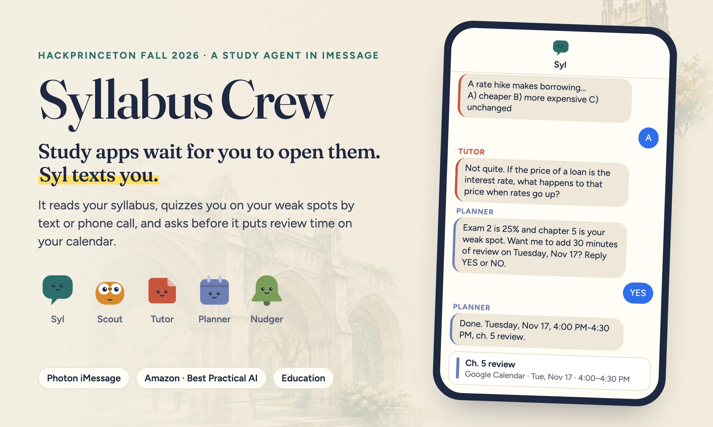
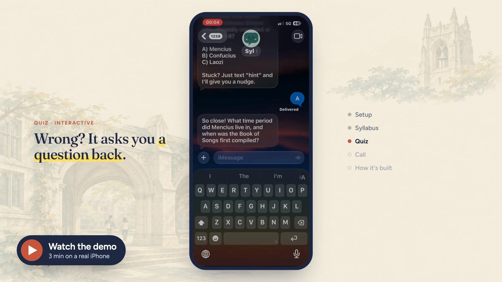
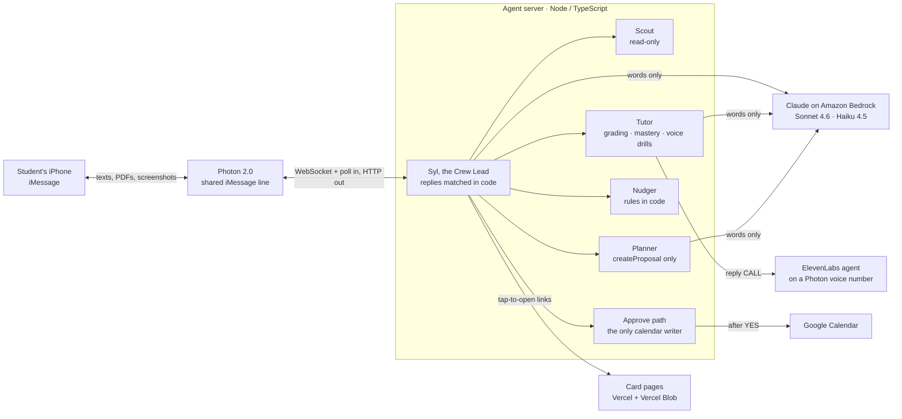
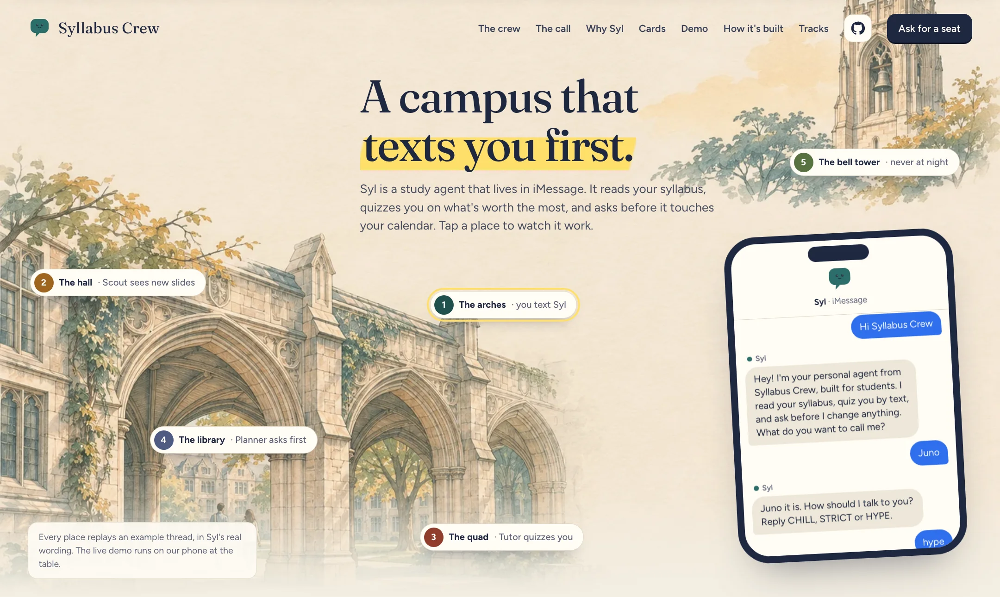

<p align="center">
  
</p>

<p align="center">
  <b><a href="https://youtu.be/frTz_ULVTXY">▶ Watch the 3-minute demo</a></b>
  &nbsp;·&nbsp;
  <b><a href="https://syllabus-crew.vercel.app">Pitch page: syllabus-crew.vercel.app</a></b>
  &nbsp;·&nbsp;
  <a href="#for-hackprinceton-judges">For judges</a>
  &nbsp;·&nbsp;
  <a href="#how-it-works">How it works</a>
  &nbsp;·&nbsp;
  <a href="#run-it">Run it</a>
</p>

**Syllabus Crew is a study agent that lives in one iMessage thread.** You text it your syllabus once. It works out what each exam is worth, quizzes you on your weak spots by text (or by phone call, if you reply CALL), and offers to put review time on your calendar. Nothing reaches your calendar until you reply **YES**.

The agent is called **Syl** by default (you can rename it). Behind Syl, four specialists split the work: **Scout**, **Tutor**, **Planner** and **Nudger**.

Built solo at **HackPrinceton Fall 2026** for three tracks: **Photon iMessage**, **Amazon · Best Practical AI**, and **Education**.

## The demo

<p align="center">
  <a href="https://youtu.be/frTz_ULVTXY"></a>
</p>

Recorded on a real iPhone against a real NYU syllabus: onboarding, the syllabus read, a quiz with a hint after a miss, a proposal, YES, the Google Calendar event, and a voice drill call. **[youtu.be/frTz_ULVTXY](https://youtu.be/frTz_ULVTXY)**

## For HackPrinceton judges

| If you have | Look at |
|---|---|
| **3 minutes** | [The demo video](https://youtu.be/frTz_ULVTXY) |
| **5 minutes** | [The pitch page](https://syllabus-crew.vercel.app): tap the campus pins to replay each crew member's real threads, play the voice drill call, and try the "Why this topic, today?" simulator (it runs the same rules as the agent) |
| **A phone** | Ask at the table for a seat. One command adds your number, and you text the line it prints. Same product, your own thread |
| **The code** | The claims below each point to the file that proves them. Start with [`approve.ts`](apps/agent/src/engine/approve.ts), [`logic.ts`](packages/core/src/logic.ts) and [`nudger.ts`](packages/core/src/nudger.ts) |

## The ten-minute walk

> It's 12:50. You just walked out of lecture, and your next class is ten minutes away across campus. Your midterm is Monday and it's 25% of your grade.
>
> The old way: find a seat, open the syllabus PDF, work out what's on the exam, quiz yourself, open your calendar, find an hour.
>
> With Syl, you do it on the walk, with your thumb.

1. **"What should I focus on this week?"** Syl answers from code: *"Focus on Ch. 5: Rates: you're at 35%, and Exam 2 is 25% of your grade in 3 days."*
2. **One question, one tap.** You answer A, B or C. Code grades it against the stored answer.
3. **Miss it, and you get a question back**, not the answer. Miss twice, and it explains.
4. **A proposal for a free slot:** *"Exam 2 is 25% and chapter 5 is your weak spot. Want me to add 30 minutes of review on Tuesday, Nov 17? Reply YES or NO."*
5. **YES**, and the event is in Google Calendar. Then Syl brings the open question back.

## What Syl does

You only ever text one agent. It matches A/B/C and YES/NO in code first, then hands everything else to the right specialist.

| Crew member | What it does | What it never does |
|---|---|---|
| **Syl**, the Crew Lead | Onboards you (you pick its name and a vibe: chill, strict or hype), then texts its own contact card with its face. Reads your syllabus PDF for real in about ten seconds and asks only for what's missing. Answers "when's the next essay?" from the syllabus, in code | Guess at a YES you didn't send. Text someone who hasn't texted first |
| **Scout** | Notices new slides and close deadlines, and tells you once | Send email, delete or edit anything |
| **Tutor** | A/B/C quizzes and rounds of five, double-checked before you see them. A hint before the answer. **Reply CALL and your phone rings** for a 3-minute voice drill: you explain the idea out loud, and it texts back what you missed. Tracks mastery per topic | Reveal the answer on the first miss. Call unless you reply CALL. Let the model do the math on your score |
| **Planner** | Proposes study blocks for weak topics on heavy exams. "Book me an hour for chapter 4 on Thursday at 3" and "make it Monday at 2pm" work by text | Touch your calendar on its own. Hold more than one proposal open |
| **Nudger** | Decides whether, which and when to nudge. "Remind me Sunday to start the essay" is always delivered. "Pause", "stop nudging me" and "resume" work | Nudge outside 9 AM–8 PM, more than 3 times a day, or mid-conversation |

**Every session ends with a link** that iMessage draws as a tap-to-open card: your semester (grade donut and timeline), your week (the proposed or booked block), a quiz round recap, and a voice drill recap. Card pages are hosted on Vercel, show no name or phone number, and ask search engines not to index them.

## How it works



**The principle: code does the math, the model writes the words.**

| In code (deterministic, tested) | Claude on Amazon Bedrock |
|---|---|
| Grading A/B/C against the stored answer | Reading the syllabus into JSON (Sonnet 4.6), then code validates it |
| Mastery: a miss keeps 70%, a right answer closes 30% of the gap ([`logic.ts`](packages/core/src/logic.ts)) | Writing quiz questions, then answering each one again on its own. If the two disagree, the question is dropped |
| Voice drill mastery: moves 45% of the way up toward your score, or 30% down ([`drills.ts`](packages/core/src/drills.ts)) | Grading a call transcript against key points |
| Priority = grade weight × weakness × 1 / days left ([`logic.ts`](packages/core/src/logic.ts)) | Socratic follow-ups after a miss |
| Matching YES/NO and A/B/C to the one pending item | Free-text chat (Haiku 4.5) |
| Nudger windows, caps, gaps and backoff ([`nudger.ts`](packages/core/src/nudger.ts)) | |
| Dates, weights, crunch weeks, free slots, "in N days" | |

Every model call has a timeout, a fallback and an acceptance check, so a slow or broken model can't stall the thread or leak an answer.

### Hard rules, enforced in code and tested

- **Only your YES writes to your calendar.** Exactly one path can write: [`approve.ts`](apps/agent/src/engine/approve.ts). The Planner has no calendar tool. A test fails if any other file writes to a calendar ([`loop.test.ts`](apps/agent/src/loop.test.ts)).
- **It never texts first into a new thread.** You text first. Every number needs a seat on the line.
- **Quiet from 11 PM to 8 AM.** Nudges only from 9 AM to 8 PM, at most 3 a day, 4 hours apart, never mid-conversation, and quiet after two ignored nudges.
- **A failed text leaves nothing behind.** Syl sends first, then records. One open quiz and one open proposal at a time.
- **Voice drills only after you reply CALL,** one a day, between 9 AM and 8 PM.

## The three tracks

### Photon iMessage

The whole product is one iMessage thread on Photon 2.0 ([`photon.ts`](apps/agent/src/adapters/photon.ts)).

- **Inbound** comes over a WebSocket with a polling fallback, deduplicated.
- **Files go both ways:** PDFs and screenshots in, a contact card (vCard) out.
- **Per-person lines on a shared pool.** Syl remembers which line each person texts, and `npm run seat` adds a person.
- **Voice drills ring from a Photon number** through ElevenLabs. When the call ends, a recap text follows in the same thread.

What we hit on Photon's beta, and how we got around it:

| Tried | What happened | What Syl does instead |
|---|---|---|
| Tapbacks | Refused on shared lines | Replies stay plain text: a YES is a YES |
| The line's name and photo | Can't be set on a shared line | Syl texts its own contact card, with a face per vibe |
| App cards in the thread | 2.0 has no mini-app card | A link iMessage draws as a card, with charts on the page |
| Typing dots | Not available on shared lines | Slow work gets a short "Got it, reading your syllabus" first, and texts are spaced so they arrive in order |

### Amazon · Best Practical AI

- **Claude on Amazon Bedrock, two models picked per task.** Sonnet 4.6 reads syllabi, writes and checks questions, and grades drills. Haiku 4.5 handles everyday chat ([`bedrock.ts`](apps/agent/src/adapters/bedrock.ts)).
- **The model writes words; code does the numbers.** Grades, mastery, priority and timing are never invented.
- **A practical safety story:** YES-gated writes, quiet hours and daily limits, all enforced in code and covered by **246 automated tests**.
- **An Amazon DynamoDB store is built** and switchable (`STORE=dynamo`, [`dynamo-store.ts`](apps/agent/src/adapters/dynamo-store.ts)). The event account's org policy blocks DynamoDB, so the demo keeps state in a local file.

### Education: personal, interactive, accessible

- **Personal.** Built from your syllabus and your mastery per topic. Study time goes where the grade weight and your weak spots are. You name the agent and pick how it talks to you.
- **Interactive.** Reply CALL and explain it out loud on a 3-minute call. It asks one follow-up, then makes sure you know the answer. Text quizzes give a hint before the answer.
- **Accessible.** No app to install and no account to make: just Messages on your iPhone and an ordinary phone call. Tap or talk, and the recap always comes back in writing.

## The pitch page

<p align="center">
  <a href="https://syllabus-crew.vercel.app"></a>
</p>

**[syllabus-crew.vercel.app](https://syllabus-crew.vercel.app)** is a static page ([`apps/site`](apps/site)) with the whole story: the crew on a campus map, a playable voice drill call, the comparison with general agents and syllabus apps, the "Why this topic, today?" simulator, the card pages, the rules, and the demo video. Every example thread uses Syl's real reply wording.

## What's ours

- **The priority score.** Grade weight × how weak you are × 1 / days left decides what you study next.
- **Questions answered twice.** Each question is written, then answered again by a separate call before you see it.
- **The YES gate.** One path writes to your calendar, and only after your YES.
- **Voice drills graded into mastery by a formula,** not by the model's opinion of you.
- **A Nudger with hard rules,** enforced and tested.
- **Our own crew, no framework.** A router and four specialists in plain TypeScript, each with its rules in a Markdown file under [`agents/`](agents).

## What's real, and what isn't yet

**Real, on a real iPhone:** iMessage via Photon, reading a texted syllabus PDF, grading, mastery and priority, written and double-checked questions, Socratic hints, proposals and moves, the approve path writing to a real Google Calendar, voice drills over a real phone call, tap-to-open cards, reminders, the Nudger's rules, and seats for other people's phones.

**Honest limits:**
- Questions come from the model's knowledge of each topic, not from the text of your readings.
- Syl knows the graded items, dates, weights and topics in a syllabus, not each class's reading list.
- Scout reads a staged inbox in the demo; reading Canvas or other LMS feeds is next.
- The agent runs on a laptop and the dashboard is local. The card pages and pitch page are hosted on Vercel.
- The scheduler defaults to `SCHEDULER=dry`, which logs the nudges it would send.
- Google Calendar runs in OAuth test mode on the builder's account. Other phones get a local stand-in calendar.

## Run it

Requirements: Node 22+ (tested on 24) and an iPhone with iMessage.

```bash
npm install
# create .env with the variables in "Setup" below

npm test -w @syllabus-crew/core -w @syllabus-crew/agent   # 246 tests on fakes, no network
npm run demo:loop -w @syllabus-crew/agent                 # the whole loop on fakes, printed as a chat

npm run start -w @syllabus-crew/agent   # the real agent: Photon + Bedrock + Google Calendar (127.0.0.1:8787)
npm run dev   -w @syllabus-crew/web     # the live dashboard and presenter controls (localhost:3000, /demo)
```

**Someone else's phone:** `npm run seat -- +1 609 555 0123` gives them a seat on the shared line and prints the line they should text (Photon picks it, so it can differ from yours). `npm run seat -- list` shows seats, and `npm run seat -- release +1...` frees one. Add their number to `TESTERS` in `.env` to lift quiz limits for them, then restart the agent.

Both servers listen on this machine only. The dashboard's presenter controls have no key, so don't deploy or tunnel it as it is.

<details>
<summary><b>Setup: services and environment variables</b></summary>

| What | Variables |
|---|---|
| **Photon 2.0 beta:** a project and a shared iMessage line with your number assigned | `PHOTON_PROJECT_ID`, `PHOTON_API_KEY`, `PHOTON_IMESSAGE_LINE` |
| **Amazon Bedrock:** Claude Haiku 4.5 and Sonnet 4.6 enabled in `us-east-1` (the `us.` inference-profile prefix is required) | `AWS_REGION`, `AWS_ACCESS_KEY_ID`, `AWS_SECRET_ACCESS_KEY`, `BEDROCK_MODEL_DEFAULT=us.anthropic.claude-haiku-4-5-20251001-v1:0`, `BEDROCK_MODEL_STRONG=us.anthropic.claude-sonnet-4-6` |
| **Google Calendar:** an OAuth client in Testing mode, `calendar.events` scope only | `GOOGLE_CLIENT_ID`, `GOOGLE_CLIENT_SECRET`, `GOOGLE_REDIRECT_URI=http://localhost:8787/auth/google/callback`. Connect once at `/auth/google?token=<DEMO_ADMIN_TOKEN>` on the agent |
| **Voice drills (optional):** an ElevenLabs agent and a Photon voice number | `ELEVENLABS_API_KEY`, `ELEVENLABS_AGENT_ID`, `ELEVENLABS_PHONE_NUMBER_ID`, `PHOTON_VOICE_NUMBER`. The agent's prompt source is [`agents/voice-drill.md`](agents/voice-drill.md) |
| **Tap-to-open cards (optional):** the [`apps/cards`](apps/cards) site on Vercel with a public Blob store | `BLOB_READ_WRITE_TOKEN`, `CARDS_URL` |
| **Amazon DynamoDB (optional):** state stays in `.data/state.json` without it | `STORE=dynamo`, optional `DYNAMODB_TABLE_PREFIX`. Run `npm run dynamo:setup -w @syllabus-crew/agent` once |
| **Demo** | `DEMO_ADMIN_TOKEN` (a long random string), `DEMO_STUDENT` (the demo phone number), `DEMO_MODE=true` (lifts quiet hours and caps for the demo student only), `TESTERS`, `STUDENT_TIMEZONE`, `SCHEDULER` (`off`, `dry` or `on`), `AGENT_PORT`, `AGENT_URL`, `DASHBOARD_URL` |

Secrets live only in `.env` and `.data/`, both gitignored. The dashboard talks to the agent through server-side routes, so the browser never sees the agent URL or the token.

</details>

## Repo layout

```
apps/agent/     The agent: engine/ (Crew Lead, Scout, Tutor, Planner, Nudger, approve path, voice drills),
                adapters/ (Photon, Bedrock, Google, ElevenLabs, Vercel cards, file and DynamoDB stores), server.ts
apps/web/       Next.js dashboard: live thread, mastery bars, proposals, /demo presenter controls
apps/cards/     Next.js card pages (semester, week, round, drill) on Vercel
apps/site/      The static pitch page at syllabus-crew.vercel.app
packages/core/  Types, interfaces, the pure logic (grading, mastery, priority, Nudger, syllabus math), fakes, tests
agents/*.md     Each agent's rules: change behavior by editing Markdown
seed/           The example ECON 201 syllabus (PDF and photo)
assets/readme/  Images on this page, and the HTML they're rendered from (source/render.sh)
SPEC.md · PLAN.md · DECISIONS.md   What it does, the build plan, and 113 numbered decisions with reasons
```

## Stack

Photon 2.0 (iMessage and voice number) · Claude Sonnet 4.6 and Haiku 4.5 on Amazon Bedrock · ElevenLabs Agents · Google Calendar API · Vercel and Vercel Blob · Next.js · Node.js and TypeScript · Amazon DynamoDB (built, blocked on the event account) · `node:test`

## What's next

- **Hosted for real,** so Syl runs while the laptop sleeps.
- **Your own Google sign-in,** so every student's YES writes to their own calendar.
- **Canvas and LMS feeds,** so Scout reads the real course page.
- **Questions from the reading itself,** built from your slides' text.
- **Every course at once:** five syllabi, one week planned across all of them.

---

<p align="center">
  Built solo by <a href="https://www.linkedin.com/in/linhua-zhou-31948b42b/">Linhua Zhou</a> at HackPrinceton Fall 2026
  &nbsp;·&nbsp; <a href="https://youtu.be/frTz_ULVTXY">Demo video</a>
  &nbsp;·&nbsp; <a href="https://syllabus-crew.vercel.app">Pitch page</a>
</p>
